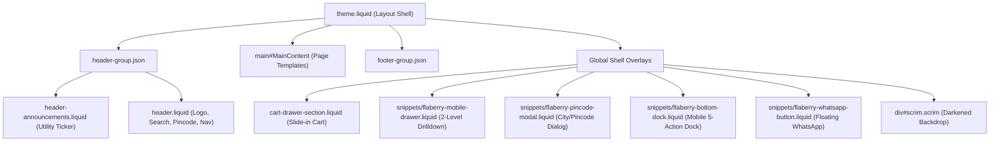

# Flaberry — Horizon Architecture Mapping

**Document Version:** 1.0.0  
**Primary Reference:** `reference/Flaberry_Design1_Classic.html`  
**Base Theme:** Shopify Horizon v4.5.0 (`c531fd5bb8904e7f871c308b15c64a7cb0de8e20`)  
**Target Market:** Global (Updated Decision D-001; detailed workflow pending)  
**Document Purpose:** Architectural blueprint bridging the client-side SPA prototype to Shopify Horizon's multi-page Theme Architecture 2.0 (OS 2.0 + Theme Blocks) paradigm.

---

## 1. Executive Architectural Comparison

The Flaberry prototype and Shopify Horizon represent two fundamentally different software architectures that must be bridged cleanly while preserving the exact customer-facing visual identity and interaction model:

```
+---------------------------------------------------------------------------------------------------------+
|                                    ARCHITECTURAL PARADIGM COMPARISON                                    |
+------------------------------------+------------------------------------+-------------------------------+
|  PROTOTYPE (Client-Side SPA)       |  HORIZON BASE (Shopify OS 2.0)     |  PRODUCTION FLABERRY THEME    |
+------------------------------------+------------------------------------+-------------------------------+
| - Single HTML document shell       | - Multi-Page Architecture (MPA)    | - Shopify Multi-Page Templates|
| - Hash routing (window.location)   | - Server-rendered Liquid templates | - Native Liquid URL routing   |
| - Dynamic DOM injection in #app    | - JSON section/block architecture  | - Modular JSON templates      |
| - In-memory / localStorage state   | - Shopify Cart API & session       | - Native Shopify Cart + Ajax  |
| - Simulated simulated backend      | - Native checkout engine           | - Shopify Checkout + Apps     |
| - Monolithic CSS & JS block        | - Granular component assets        | - Horizon asset pipeline      |
| - Mock Vendor & Admin portals      | - Storefront customer scope only   | - Dedicated App/Backend scope |
+------------------------------------+------------------------------------+-------------------------------+
```

### 1.1 Single-Page Application (SPA) vs. Multi-Page Architecture (MPA)
- **Prototype Behavior:** The prototype loads once (`index.html`) and intercepts navigation via `window.location.hash`. A custom router (`routeBase()`, lines 1640–1667) swaps inner HTML into `<main id="app"></main>` across 20 defined route patterns and maintains state in memory (`S = {}`) and `localStorage`.
- **Shopify Horizon Implementation:** Shopify renders distinct URLs on the server (`/`, `/collections/<handle>`, `/products/<handle>`, `/cart`, `/checkout`, `/pages/<handle>`, `/blogs/<blog>/<article>`, `/search`, `/account`). The Shopify Liquid engine generates semantic HTML on each request, augmented by Horizon's client-side web components (`cart-drawer`, `accordion`, `predictive-search`).
- **Architectural Decision:** Flaberry will adopt **Shopify's native Multi-Page Architecture (MPA)**. All 20 prototype route patterns will map directly to standard Shopify URL paths and JSON templates. This ensures full SEO discoverability, native browser history management, Shopify Markets localization, social sharing previews, and optimal caching across Shopify's global CDN.

### 1.2 Layout Chrome & Mode Management
- **Prototype:** Controls global chrome visibility via `document.body.dataset.mode` (`store`, `checkout`, `panel`).
- **Shopify Implementation:**
  - **Storefront Chrome:** Managed in `theme.liquid` via `` and ``. Active across all customer-facing storefront pages.
  - **Checkout Chrome:** Shopify handles checkout within its secure, isolated checkout domain (`/checkout`) using Shopify Checkout Extensibility. Header, footer, and dock chrome are natively isolated without custom body attributes.
  - **Vendor & Admin Interfaces:** Completely extracted from the theme repository. Vendor operations belong to an approved Marketplace App (e.g., Webkul), and administrative oversight belongs to Shopify Admin and the custom backend allocation engine.

---

## 2. Complete Prototype Route to Horizon Template Mapping

Every page and screen identified in [PROTOTYPE_ANALYSIS.md](file:///e:/Flaberry-Shopify/documentation/PROTOTYPE_ANALYSIS.md) maps to a specific Shopify URL, Horizon template, and architectural implementation mechanism:

| # | Prototype Hash Route | Prototype Function | Shopify Production URL | Horizon Template | Horizon Section / Implementation Type | Architecture Classification |
|---|---|---|---|---|---|---|
| 1 | `#home` | `home()` | `/` | `templates/index.json` | `header-group`, `hero`, `product-list`, custom sections | Native Shopify Liquid Template |
| 2 | `#tour` | `home()` + `guide()` | `/?tour=1` or modal | `templates/index.json` | Embedded walkthrough script `snippets/flaberry-tour.liquid` | Liquid Snippet + Client JS |
| 3 | `#c-<key>` | `collection(k)` | `/collections/<handle>` | `templates/collection.json` | `main-collection.liquid` + `blocks/filters.liquid` | Native Shopify Collection Template |
| 4 | `#p-<key>` | `product(k)` | `/products/<handle>` | `templates/product.json` | `product-information.liquid` + custom blocks | Native Shopify Product Template |
| 5 | `#cart` | `cartPage()` | `/cart` | `templates/cart.json` | `sections/main-cart.liquid` (customized line items) | Native Shopify Cart Template |
| 6 | `#checkout` | `checkout()` | `/checkout` | Shopify Native Checkout | Checkout Extensibility / Custom UI Extensions | Shopify Native Checkout Engine |
| 7 | `#thanks-<id>` | `thanks(id)` | `/checkout/thank-you` | Shopify Thank You Page | Checkout Order Status Script / Custom App block | Shopify Native Order Engine |
| 8 | `#track` | `track()` | `/pages/track-order` | `templates/page.track.json` | Custom section `sections/flaberry-order-lookup.liquid` | Theme Page + Custom Backend API |
| 9 | `#track-<id>` | `track(id)` | `/pages/track-order?id=X`| `templates/page.track.json` | Custom status stepper `snippets/flaberry-track-stepper.liquid` | Theme Page + Custom Backend API |
| 10 | `#login` | `login("login")` | `/account/login` | `templates/customers/login.json` | `sections/main-login.liquid` | Native Shopify Customer Accounts |
| 11 | `#signup` | `login("signup")`| `/account/register` | `templates/customers/register.json`| `sections/main-register.liquid` | Native Shopify Customer Accounts |
| 12 | `#reset` | `login("reset")` | `/account/login#recover`| `templates/customers/reset_password.json`| `sections/main-reset-password.liquid` | Native Shopify Customer Accounts |
| 13 | `#account` | `account()` | `/account` | `templates/customers/account.json` | `sections/main-account.liquid` + order history | Native Shopify Customer Accounts |
| 14 | `#page-<id>` | `page(id)` | `/pages/<handle>` | `templates/page.json` | `sections/main-page.liquid` + content sections | Native Shopify Pages (10 pages) |
| 15 | `#blog-<id>` | `blogPost(id)` | `/blogs/<blog>/<handle>`| `templates/article.json` | `sections/main-blog-post.liquid` | Native Shopify Blog Article |
| 16 | `#city-<city>` | `cityPage(c)` | `/pages/city-<handle>` or `/collections/city-<handle>` | `templates/page.city.json` | Custom section `sections/flaberry-city-landing.liquid` | Metaobject Template / Collection |
| 17 | `#search-<query>`| `searchPage(q)` | `/search?q=<query>` | `templates/search.json` | `sections/search-results.liquid` + `predictive-search` | Native Shopify Search Engine |
| 18 | `#not-serviceable`| `notServiceable()`| `/pages/unserviceable` | `templates/page.json` (custom) | Custom section `sections/flaberry-unserviceable.liquid` | Informational Page / Dynamic Modal |
| 19 | `#vendor` | `vendorPanel()` | External Portal URL | External App Domain | Marketplace Application (e.g., Webkul Vendor Portal) | Third-Party App / Custom Backend |
| 20 | `#admin` | `adminPanel()` | External Admin URL | Shopify Admin / Backend | Shopify Admin + Custom Allocation Service | Shopify Admin / Custom Backend |
| 21 | `*` (Catch-all) | `notFound()` | Any unmatched URL | `templates/404.json` | `sections/main-404.liquid` | Native Shopify 404 Error Template |

---

## 3. Global UI Shell Components Mapping

Global interactive containers in the prototype do not represent independent URL routes. They exist in the outer layout shell and toggle dynamically across pages:



### 3.1 Global Shell Component Details
1. **Utility Announcement Bar (`.ubar` / `.tk`):**
   - **Horizon Equivalent:** `sections/header-announcements.liquid` + `blocks/_announcement.liquid`.
   - **Customization Required:** Reconfigure speed and style tokens to match Flaberry's 28px height, cream background (`#faf5ee`), and multi-announcement rotation (`rotateTicker()`).
2. **Main Header (`.hdr` / `.fbhdr`):**
   - **Horizon Equivalent:** `sections/header.liquid`.
   - **Customization Required:** Inject the interactive Pincode Delivery Trigger (`#pinbtn`), Currency Selector (`#curbtn`), and search modal trigger into the top row layout.
3. **Desktop Mega Menu (`#nav`, `.mega`):**
   - **Horizon Equivalent:** `blocks/_header-menu.liquid`.
   - **Customization Required:** Horizon's default menu renders simple nested links or basic featured collections. Flaberry requires a structured 5-column subcategory matrix + 1 promotional visual card (`t_redrose`, `t_bday`, etc.) with 120ms debounce timing.
4. **Slide-in Cart Drawer (`#cartdrawer`):**
   - **Horizon Equivalent:** `snippets/cart-drawer.liquid` + `sections/cart-drawer-section.liquid`.
   - **Customization Required:** Horizon natively displays items, quantities, and subtotal. Flaberry requires displaying custom line item attributes: Delivery Date (`_delivery_date`), Time Slot (`_delivery_slot`), Card Message (`_message_text`), and Weight/Eggless selection.
5. **Mobile Navigation Drawer (`#mobmenu`):**
   - **Horizon Equivalent:** Horizon's native drawer inside `sections/header.liquid`.
   - **Customization Required:** Horizon uses standard nested accordions. Flaberry's design requires a 2-level screen replacement drilldown (Level 1: master categories -> Level 2: subcategories with `‹ All categories` back button) and bottom utility links.
6. **Mobile Bottom Navigation Dock (`.dock`):**
   - **Horizon Equivalent:** None (Horizon does not include a fixed bottom mobile navigation dock).
   - **Customization Required:** Create a net-new persistent component `snippets/flaberry-bottom-dock.liquid` rendering 5 action triggers: Home, Menu (`#dockmenu`), Search (`#docksearch`), Cart with badge (`#dockcart`), and Account (`#dockaccount`), active on viewports `<=960px`.
7. **Pincode Selection Modal (`#modal`):**
   - **Horizon Equivalent:** None (Horizon provides no native pincode validator).
   - **Customization Required:** Create a net-new dialog component `snippets/flaberry-pincode-modal.liquid` supporting 6-digit Indian pincode input, quick city chips (Delhi, Mumbai, Bengaluru, Kolkata, Chennai, Hyderabad, Pune, Gurgaon), and localStorage persistence (`FB_PIN`).
8. **Floating WhatsApp Button (`.wa`):**
   - **Horizon Equivalent:** None.
   - **Customization Required:** Create a net-new fixed widget `snippets/flaberry-whatsapp-button.liquid` with tooltip pulse animation and pre-filled message template.

---

## 4. Required Shopify Data Structures & Primitives

To reproduce Flaberry's gifting catalog, custom delivery parameters, and occasion flows, Shopify's data primitives must be structured as follows:

### 4.1 Products & Variant Modeling
- **Standard Floral & Gift Products:** Modeled as standard Shopify products with single variant (Base) or size variants (Standard, Deluxe, Premium).
- **Celebration Cakes:** Modeled with multi-axis variant options:
  - Option 1 (`Weight`): `0.5 kg`, `1.0 kg`, `1.5 kg`, `2.0 kg`, `3.0 kg`, `4.0 kg`.
  - Option 2 (`Dietary / Egg Type`): `Eggless`, `With Egg` (or captured via line-item property if price is invariant).
  - Photo Cakes: Captured via custom line-item property (`properties[_photo_upload]`) using an HTML file upload input.

### 4.2 Product Metafields (Namespace: `custom`)
The following metafield definitions must be registered in Shopify Admin:

| Metafield Key | Type | Description / Prototype Usage |
|---|---|---|
| `custom.is_perishable` | `boolean` | Flags fresh flowers/cakes requiring local florist routing vs courier shipment |
| `custom.lead_time_hours` | `number_integer` | Minimum preparation buffer required before earliest eligible delivery slot |
| `custom.cutoff_time` | `single_line_text_field` | Daily order cutoff time (e.g. `19:00`) for same-day delivery eligibility |
| `custom.delivery_slot_types` | `list.single_line_text_field` | Supported slot types (`standard`, `fixed_time`, `midnight`, `early_morning`) |
| `custom.care_instructions` | `rich_text_field` | Care instructions tab content (flower watering, cake refrigeration) |
| `custom.specifications` | `rich_text_field` | Item specifications tab content (stem count, cake ingredients) |
| `custom.addon_products` | `list.product_reference` | Curated upsell products (teddy bear, chocolates, greeting card) |
| `custom.vendor_sku` | `single_line_text_field` | Master vendor product identifier for automatic order allocation |

### 4.3 Order & Line-Item Properties (Cart Attributes)
When a customer adds a gifting item to cart, the custom PDP form dispatches attributes stored in the line item:

| Property Key | Format | Example Value | Purpose |
|---|---|---|---|
| `_delivery_date` | `YYYY-MM-DD` | `2026-11-20` | Selected delivery date |
| `_delivery_slot_type` | `string` | `fixed_time` | Slot tier: `standard`, `fixed_time`, `midnight`, `early_morning` |
| `_delivery_slot_time` | `string` | `15:00 - 16:00` | Specific delivery window |
| `_delivery_pincode` | `string` | `110001` | Destination Indian postal pincode |
| `_delivery_city` | `string` | `Delhi` | Serviceable destination city |
| `_message_occasion` | `string` | `Birthday` | Selected greeting occasion |
| `_message_text` | `string` | `Happy Birthday! Wishing you joy!` | Custom printed greeting card text (max 250 chars) |
| `_message_sender` | `string` | `Rohit & Family` | Sender name printed on card |
| `_message_on_cake` | `string` | `Happy B'day Anita` | Custom frosting text on cake (max 30 chars) |
| `_cake_egg_option` | `string` | `Eggless` | Selected dietary specification |
| `_cake_weight` | `string` | `1.0 kg` | Selected cake size |

### 4.4 Metaobjects Architecture
Custom Metaobjects provide the structured data for localized and scheduled commerce:
1. **`delivery_slot_tier`:** Defines slot rules (`tier_name`, `base_fee`, `cutoff_time`, `display_title`, `badge_color`).
2. **`city_landing_page`:** Powers localized city pages (`city_name`, `hero_headline`, `local_florist_quote`, `delivery_cutoffs`, `featured_collection_handle`).
3. **`serviceable_pincode_zone`:** Manages Indian pincode coverage (`pincode`, `city`, `state`, `tier_classification`, `eligible_for_midnight`).

---

## 5. Architectural Boundaries: Theme vs. Native Shopify vs. External Backend

A rigorous distinction between system responsibilities is required to ensure stability, security, and scalability:

```
+---------------------------------------------------------------------------------------------------------+
|                                    RESPONSIBILITY MATRIX ACROSS TIERS                                   |
+------------------------------------+------------------------------------+-------------------------------+
|  1. SHOPIFY HORIZON THEME          |  2. SHOPIFY PLATFORM (Native)      |  3. EXTERNAL APPS & BACKEND   |
+------------------------------------+------------------------------------+-------------------------------+
| - Storefront presentation & styling| - Product catalog & media storage  | - Multi-Vendor Marketplace App|
| - Responsive layouts & viewports   | - Variant pricing & inventory sync | - Pincode distance router     |
| - Header, mega menu, mobile dock   | - Customer accounts & authentication| - Vendor order allocation engine|
| - Pincode checker UI & validation  | - Cart state & session persistence | - Vendor portal & order queues|
| - 14-day date picker & slot UI     | - Native checkout & payment gateway| - Packing slip PDF generation |
| - Message card builder form        | - Order creation & webhooks        | - Vendor settlement ledger    |
| - Addon upsell presentation        | - Transactional confirmation emails| - WhatsApp Business API engine|
| - Product tabs, reviews, FAQs      | - Shopify Markets currency display | - SMS gateway integration     |
| - Cart drawer line-item metadata   | - Automated order archiving        | - Courier tracking webhook sync|
+------------------------------------+------------------------------------+-------------------------------+
```

---

## 6. Approved Decisions vs. Proposed Implementations vs. Pending Approvals

| Area | Decision / Feature | Status | Details & Implementation Constraint |
|---|---|---|---|
| **Market Scope** | Global | **Approved (Updated D-001)** | Storefront built with Shopify Markets localization; no hardcoded countries or currencies. Workflow details pending. |
| **Product Model** | Central + Vendor Products | **Approved** (D-002) | Hybrid catalog supported. Theme presents all items uniformly to shoppers. |
| **Order Allocation** | Automatic Routing | **Approved** (D-004) | Automatic routing by availability, inventory, eligibility, and distance. Distance alone must not dictate selection. |
| **Manual Allocation**| On-Hold Orders Queue | **Approved Fallback** | Manual review is strictly an operational exception / fallback, not the primary workflow. Prototype manual queue will not supersede automatic routing. |
| **Payments** | Central Flaberry Collection| **Approved** (D-005) | Customer pays Flaberry via Shopify checkout; vendors are settled separately. |
| **Currency Display** | Multi-Currency vs. INR Only| **Pending Decision** | Prototype has 11-currency dropdown. Whether to retain multi-currency browsing for diaspora senders or lock strictly to INR requires project owner confirmation. |
| **Vendor Settlement**| Commission & Payout Schedule| **Pending Decision** | Payout frequency (weekly/monthly) and commission tiers remain pending approval. Managed in backend, zero theme impact. |
| **Tie-Breaker Rules**| Routing Vendor Conflict | **Pending Decision** | Criteria for choosing between multiple equally serviceable vendors (rating, on-time rate, round-robin) remains pending. |
| **Marketplace App** | Vendor Portal Provider | **Proposed** | Candidate: Webkul MultiVendor Marketplace. Pending technical validation in Phase 7. |
| **Hosting & Backend**| Custom Routing Engine | **Proposed** | Node.js / Serverless microservice on AWS or GCP. Pending technical validation. |
