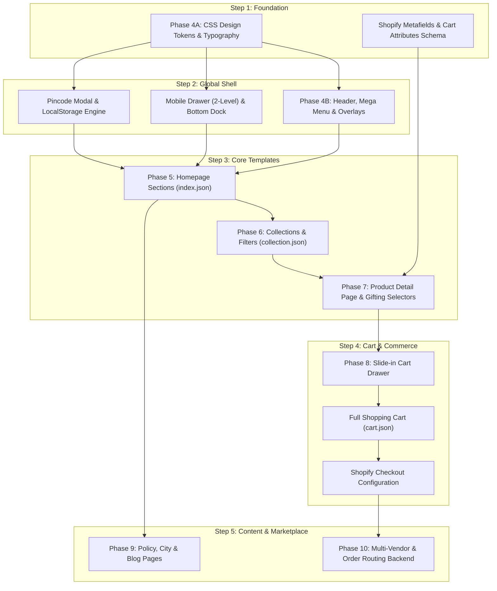

# Flaberry — Implementation Sequence & Engineering Roadmap

**Document Version:** 1.0.0  
**Primary Reference:** `reference/Flaberry_Design1_Classic.html`  
**Base Theme:** Shopify Horizon v4.5.0  
**Target Market:** Global (Updated Decision D-001; detailed workflow pending)  
**Document Purpose:** Sequential engineering roadmap, dependency graph, and phase-by-phase implementation plan for building the Flaberry Shopify storefront from the Horizon base theme.

---

## 1. Technical Dependency Graph & Critical Path

Building a complex e-commerce gifting platform requires strict dependency ordering. Attempting to build downstream templates before upstream data primitives and global shells are in place causes rework and syntax inconsistencies:



### Critical Dependency Rules
1. **Design Tokens First:** The Flaberry typography (`Playfair Display`, `Plus Jakarta Sans`), luxury maroon (`#8c1d40`), blush pink (`#fdf4f4`), gold accent (`#d4af37`), and card elevation shadows must be declared in Horizon's CSS token pipeline before any section markup is styled.
2. **Global Chrome Precedes Interior Pages:** The announcement ticker, main header, mega menu, mobile bottom dock, and pincode selector modal must be operational first, as they frame every customer interaction.
3. **Cart Attributes Specification Precedes PDP Selectors:** The naming convention for line-item properties (`_delivery_date`, `_delivery_slot_time`, `_message_text`, `_cake_weight`) must be strictly locked before coding the PDP forms, because the Cart Drawer and Cart Page directly consume these exact property keys.
4. **Theme Presentation Precedes Marketplace Backend:** The storefront can be fully developed and previewed using native Shopify mock products and line-item properties before the external multi-vendor app and automated order routing backend are connected.

---

## 2. Phase-by-Phase Engineering Roadmap

```
+---------------------------------------------------------------------------------------------------------+
|                                    FLABERRY STOREFRONT ROADMAP SUMMARY                                  |
+------------------------------------+------------------------------------+-------------------------------+
|  PHASE                             |  KEY DELIVERABLES                  |  ESTIMATED EFFORT / COMPLEXITY|
+------------------------------------+------------------------------------+-------------------------------+
|  Phase 4A: Design Tokens & Styling | CSS custom properties, fonts, cards| Low / Foundational            |
|  Phase 4B: Global Storefront Chrome| Header, Mega Menu, Dock, Modals    | High / Core Layout            |
|  Phase 5: Homepage Sections        | 14 index.json sections, rails, tabs| High / High Visual Impact     |
|  Phase 6: Collection Catalogue     | collection.json, filters, sorting  | Medium / Commerce             |
|  Phase 7: Product Detail Page (PDP)| Date picker, slot chips, cards     | Very High / Complex Gifting   |
|  Phase 8: Shopping Cart & Drawer   | Cart drawer, cart.json, line items | Medium / State & Pricing      |
|  Phase 9: Secondary & City Pages   | 10 policy pages, city metaobjects  | Low-Medium / Content          |
|  Phase 10: Multi-Vendor Backend    | Routing engine, vendor app, notify | High / Architectural Backend  |
+------------------------------------+------------------------------------+-------------------------------+
```

---

### Phase 4A — Global Design System & CSS Token Foundation
- **Objective:** Configure Horizon's design token architecture to inject Flaberry's exact visual identity without breaking native Horizon styles.
- **Key Tasks:**
  1. Register Google Fonts in `theme.liquid`: `Playfair Display` (Headings) and `Plus Jakarta Sans` (Body & UI text).
  2. Declare Flaberry CSS custom property tokens in `assets/base.css` or dedicated stylesheet `assets/flaberry-tokens.css`:
     - Palette: `--fl-maroon: #8c1d40;`, `--fl-maroon-dark: #661028;`, `--fl-pink: #fdf4f4;`, `--fl-cream: #faf5ee;`, `--fl-gold: #d4af37;`, `--fl-dark: #151312;`, `--fl-muted: #726c66;`, `--fl-line: #ece6df;`.
     - Shadows: `--fl-shadow-card: 0 4px 16px rgba(21,19,18,0.06);`, `--fl-shadow-modal: 0 18px 40px rgba(21,19,18,0.14);`, `--fl-shadow-dock: 0 -6px 20px rgba(34,35,92,0.07);`.
     - Radii: `--fl-radius-card: 16px;`, `--fl-radius-pill: 9999px;`, `--fl-radius-button: 8px;`.
  3. Map tokens into Horizon's `settings_schema.json` and `snippets/theme-styles-variables.liquid`.
- **Quality Gate:** Typography, primary colors, button styles, and card elevation render identically to prototype visual references in desktop and mobile viewports.

---

### Phase 4B — Storefront Chrome & Global Navigation
- **Objective:** Implement Flaberry's top utility bar, main header, mega menu, mobile drawer, mobile bottom dock, and modal dialogs.
- **Key Tasks:**
  1. Configure `sections/header-announcements.liquid` for the 28px cream utility ticker with rotation timing.
  2. Modify `sections/header.liquid` to introduce Flaberry's 4-column layout, sticky border on scroll, and pincode location trigger (`#pinbtn`).
  3. Extend `blocks/_header-menu.liquid` to render the 5-column subcategory matrix and right-hand promo card with 120ms debounce timing.
  4. Create `snippets/flaberry-mobile-drawer.liquid` implementing the 2-level category drilldown navigation for viewports `<=960px`.
  5. Create `snippets/flaberry-bottom-dock.liquid` providing the persistent 5-action bottom bar on mobile screens.
  6. Create `snippets/flaberry-pincode-modal.liquid` with Indian 6-digit validation, city chips, and `localStorage` persistence.
  7. Create `snippets/flaberry-whatsapp-button.liquid` with floating pulse badge.
- **Quality Gate:** Navigation works seamlessly across desktop (hover mega menus) and mobile (left drawer drilldown + bottom dock); pincode modal updates location label dynamically.

---

### Phase 5 — Storefront Homepage Implementation (`index.json`)
- **Objective:** Construct the complete 14-section Flaberry homepage layout.
- **Key Tasks:**
  1. Configure Hero Carousel (`sections/slideshow.liquid` or custom hero) with 5 luxury gifting slides and swipe support.
  2. Build `sections/flaberry-pincode-band.liquid` (gold/cream delivery reassurance bar).
  3. Build `sections/flaberry-category-tiles.liquid` (16 circular category tiles with horizontal snap-scrolling).
  4. Build `sections/flaberry-authority-stats.liquid` (4 authority metrics: 20+ Yrs, 400+ Cities, 1.2M+ Deliveries, 4.8★).
  5. Configure `sections/collection-list.liquid` for the 5 category showcase cards (Flowers, Cakes, Combos, Plants, Hampers).
  6. Implement Curated Product Rails (`sections/product-list.liquid` with `snippets/flaberry-product-card.liquid`).
  7. Build `sections/flaberry-usp-highlights.liquid` (5 service commitment icons).
  8. Build `sections/flaberry-cake-tabs.liquid` (tabbed cake flavour and design filter).
  9. Configure Split Combo Banner (`sections/media-with-content.liquid` + 4-product grid).
  10. Build `sections/flaberry-seasonal-rail.liquid` with live event countdown timer.
  11. Build Customer Testimonials section and Trust Reassurance pillars.
  12. Configure Expandable SEO text accordion (`blocks/accordion.liquid`) and newsletter subscription box.
- **Quality Gate:** Visual hierarchy, typography, image cards, and interactive rails match `screenshots/desktop/home-desktop.png` and `screenshots/mobile/home-mobile.png`.

---

### Phase 6 — Collection & Catalogue Experience (`collection.json`)
- **Objective:** Implement the multi-vendor gifting collection catalogue.
- **Key Tasks:**
  1. Configure collection hero banner (`.cbanner`) with title, breadcrumbs, and introductory SEO text.
  2. Customize faceted filters (`blocks/filters.liquid`) for gifting attributes: Price brackets, Cake Flavours, Eggless toggle, Minimum 4.5★ rating.
  3. Implement sorting toolbar (Popularity, Price Low to High, Price High to Low, Rating, Newest).
  4. Render 4-column responsive product grid (2 columns on mobile) using `snippets/flaberry-product-card.liquid`.
  5. Configure numbered pagination controls.
- **Quality Gate:** Catalogue matches `screenshots/desktop/collection-desktop.png` and `screenshots/mobile/collection-mobile.png`; filtering updates product grid without layout breakage.

---

### Phase 7 — Product Detail Page (PDP) & Gifting Engine (`product.json`)
- **Objective:** Recreate Flaberry's gifting product experience with scheduled delivery and personalization.
- **Key Tasks:**
  1. Configure 4-angle zoom media gallery with vertical thumbnail strip (desktop) and horizontal slider (mobile).
  2. Implement dynamic price display with MRP strike-through and occasion badge.
  3. Build `blocks/flaberry-pdp-pincode.liquid` (real-time deliverability validator).
  4. Build `blocks/flaberry-delivery-date.liquid` (14-day date selector chips + advance date picker).
  5. Build `blocks/flaberry-delivery-slots.liquid` (Standard, Fixed Time, Midnight, Early AM with live surcharges).
  6. Build `blocks/flaberry-gift-message.liquid` (Occasion chips, 250-character live counter textarea, cake message input).
  7. Implement Cake Weight variant chips (0.5kg to 4kg) and Eggless specification.
  8. Build Addon Upsell checklist (Teddy, Chocolates, Greeting Cards).
  9. Build `snippets/flaberry-mobile-sticky-buy.liquid` (persistent bottom buy bar on mobile viewports).
  10. Configure 4 Information Tabs (Description, Specifications, Delivery Information, Care Instructions).
- **Quality Gate:** Adding a product successfully attaches all line-item attributes (`_delivery_date`, `_delivery_slot_time`, `_message_text`, `_cake_weight`) to the cart item payload.

---

### Phase 8 — Shopping Cart & Drawer Experience
- **Objective:** Seamlessly present gifting metadata and delivery slot surcharges in the cart.
- **Key Tasks:**
  1. Modify `snippets/cart-drawer.liquid` to display delivery date, time slot, and printed message card preview per line item.
  2. Customize `sections/main-cart.liquid` (`cart.json`) for full-page cart review with line item property chips.
  3. Implement Multi-Pincode Warning Banner when items in cart are addressed to different Indian pincodes.
  4. Integrate delivery slot fee calculation into order summary before checkout redirect.
- **Quality Gate:** Cart drawer opens smoothly; line item properties display accurately; total amounts reflect item prices and slot fees; checkout button routes directly to `/checkout`.

---

### Phase 9 — Secondary Pages & Informational Templates
- **Objective:** Implement static policies, editorial articles, search results, and 404 pages.
- **Key Tasks:**
  1. Configure `templates/page.json` for 10 informational policy pages (About, Contact, FAQ, Terms, Privacy, Refund, Shipping, Pincodes, Corporate, Partner).
  2. Build `templates/page.city.json` powered by Metaobjects for localized city landing pages.
  3. Style `templates/article.json` and `templates/blog.json` for editorial content marketing.
  4. Configure `templates/search.json` with predictive search suggestions.
  5. Style `templates/404.json` with branded graphics and navigation recovery CTA.
- **Quality Gate:** All secondary routes load cleanly with structured breadcrumb navigation.

---

### Phase 10 — Multi-Vendor Marketplace & Custom Backend Integration
- **Objective:** Transition simulated prototype marketplace operations into secure production systems.
- **Key Tasks:**
  1. Install and configure approved Multi-Vendor Marketplace App (e.g., Webkul) for partner onboarding and vendor catalog sync.
  2. Deploy Custom Order Routing Engine (Decision D-004) to listen for Shopify `orders/create` webhooks.
  3. Implement automated vendor allocation algorithm evaluating availability, vendor inventory, delivery eligibility, and distance.
  4. Connect WhatsApp Business API and SMS gateways for real-time order tracking notifications.
  5. Establish vendor payout settlement workflow.
- **Quality Gate:** Real orders automatically allocate to the nearest serviceable partner florist; vendor receives order in dashboard; customer receives WhatsApp notification.

---

## 3. Recommended First Development Task

### Task 4A.1: Establish Flaberry Design Token System & CSS Foundation

To initiate theme development safely without breaking Horizon's existing codebase, the first development step must establish the design token foundation:

#### Exact Scope of Task 4A.1:
1. **Target Files:**
   - Create: `theme/assets/flaberry-tokens.css` (Contains all Flaberry CSS custom properties, palette, card elevations, button styles, and typography tokens).
   - Edit: `theme/layout/theme.liquid` (Link Google Fonts `Playfair Display` and `Plus Jakarta Sans`; render `flaberry-tokens.css`).
2. **Acceptance Criteria:**
   - Fonts load without visual layout shifts.
   - Flaberry maroon (`#8c1d40`), blush pink (`#fdf4f4`), and cream (`#faf5ee`) tokens are available globally in the CSS scope.
   - Existing Horizon sections continue rendering without regression.
   - Theme check passes without new syntax errors.

---

## 4. Unresolved Questions & Approval Gate

Before writing code for subsequent phases, the following business decisions require project owner resolution:

1. **Global Market & Currency Configuration (Updated Decision D-001):**
   - *Status:* Client has confirmed global market scope; detailed documented workflow is pending. Storefront architecture uses Shopify Markets localization (`localization.available_countries` & `localization.available_currencies`) dynamically without hardcoding countries or currencies. Specific country routing and shipping rules remain pending workflow document.
2. **Order Routing Tie-Breaker Rules (Decision D-004):**
   - *Question:* When multiple partner florists are equally eligible, serviceable, and within proximity, what tie-breaker should govern automated allocation (historical vendor rating, on-time percentage, or round-robin)?
3. **Vendor Marketplace Application Selection:**
   - *Question:* Confirm whether Webkul MultiVendor Marketplace is approved for Phase 10 vendor onboarding and portal access.
