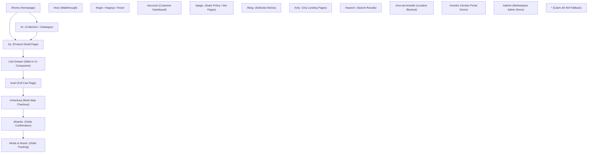

# Flaberry — Complete Technical Prototype Analysis

**Document Type:** Master Technical Blueprint & Storefront Architecture Analysis  
**Project:** Flaberry Shopify Storefront + Multi-Vendor Marketplace  
**Market:** India Only  
**Primary Source Reference:** `reference/Flaberry_Design1_Classic.html` (10.5 MB, 2,151 lines)  
**Visual References:** `screenshots/desktop/` and `screenshots/mobile/`  
**Base Theme Foundation:** Shopify Horizon (Selected starting foundation)  
**Status:** Source-verified (Static Code & Screenshot Inspection); Not tested in a live browser  

---

> [!NOTE]
> **Executive Verification Summary & Scope:**
> - **What was inspected in source:** The complete 10.5 MB source file `reference/Flaberry_Design1_Classic.html` (CSS styles, HTML DOM skeleton, 426 base64 embedded assets, 39 categories, 372 catalog products, store rules, and 117 JavaScript functions) and 8 reference PNG screenshots across desktop and mobile.
> - **What was tested in a live browser:** **None.** Live browser runtime execution, user form submissions, payment gateway simulation, live cart additions, and dynamic drawer animations were not executed in a live browser session. All findings reflect rigorous static source code analysis.
> - **What remains unverified:** Live payment gateway network latency, video playback streaming (empty placeholder container in prototype), vendor SMS/WhatsApp API credentials, and multi-vendor webhook response handling.
> - **Pending Business Decisions:** Currency selector retention vs. India-only market (Decision D-001), vendor commission percentages, settlement schedules, and automated routing tie-breakers.

---

# 1. Prototype Overview

The primary source file `reference/Flaberry_Design1_Classic.html` is a fully self-contained, single-file interactive prototype (10,504,274 bytes). It is not a static HTML wireframe; it contains a complete, functioning client-side Single-Page Application (SPA) including:
1. **Embedded Global Stylesheet (Lines 10–721):** 712 lines of CSS defining CSS custom property design tokens, layout cards, responsive media queries, grid systems, and component styles.
2. **HTML5 Document Shell (Lines 722–759):** Semantic structural skeleton housing the announcement bar (`.ubar`), page card (`.page`), sticky header (`.hdr`), main dynamic view container (`<main id="app"></main>`), global footer (`#footer`), side drawers (`#cartdrawer`, `#mobmenu`), mobile bottom dock (`.dock`), dialog modals (`#modal`), backdrop scrim (`#scrim`), and toast notifications (`#toast`).
3. **Embedded Image Data Lake (`window.IMG`, Line 760):** A 10.2 MB JSON dictionary storing 426 base64-encoded WebP and PNG data URIs (372 product catalog images and 54 brand/promotional visual assets).
4. **Catalogue Hierarchy (`window.CAT`, Line 761):** 39 product categories organized into 5 primary groups (`flowers`, `cakes`, `combos`, `gifts`, `occasions`) and 372 detailed product data models with SKUs, pricing, ratings, reviews, and category mappings.
5. **Store Configuration & Rules (Lines 762–934):** JavaScript data structures configuring navigation hierarchies, 15 fulfillment vendors (including central Flaberry warehouse), 19 Indian pincodes, delivery time slots, blackout dates, advance booking limits, surge/occasion pricing rules, 11 currency exchange rates, coupons, greeting card templates, international phone dial codes, reviews, and FAQs.
6. **Application Logic & Routing Engine (Lines 935–2150):** 117 functions implementing client-side hash routing (`#<route>`), dynamic DOM rendering, multi-currency recalculation, pincode serviceability validation, cart persistence (`localStorage`), multi-step checkout simulation, customer account dashboard, vendor order management, and marketplace administrative controls.

---

# 2. Source Files Inspected

| File Path | File Type / Dimensions | Byte Size | Purpose & Findings |
|---|---|---|---|
| `reference/Flaberry_Design1_Classic.html` | HTML5 / CSS3 / Vanilla JS | 10,504,274 bytes | Primary design and functional source of truth. Contains full storefront, catalog data, images, and SPA logic. |
| `screenshots/desktop/home-desktop.png` | PNG (1366 x 7023 px) | 6,264,926 bytes | Full-length desktop homepage capture. Confirms 10-item navigation, hero carousel, pincode band, category rails, split combo section, reviews, and 4-column footer. |
| `screenshots/desktop/desktop-menu.png` | PNG (1355 x 390 px) | 121,876 bytes | Expanded desktop mega menu dropdown under "Flowers". Confirms 5 subcategory columns plus promotional card. |
| `screenshots/desktop/collection-desktop.png` | PNG (1366 x 4050 px) | 3,407,218 bytes | Desktop collection catalogue capture. Confirms sidebar filters, sorting toolbar, 4-column product grid, and pagination. |
| `screenshots/desktop/PDP-desktop.png` | PNG (1366 x 4835 px) | 2,961,655 bytes | Desktop product detail page capture. Confirms vertical gallery thumbnails, delivery pincode checker, 14-day date picker, time slot selector, message card builder, addons, tabs, and reviews. |
| `screenshots/mobile/home-mobile.png` | PNG (245 x 5243 px) | 1,092,662 bytes | Mobile smartphone homepage capture. Confirms 3-item header, stacked hero visual, 2-column product grids, 72% peek rails, compact mobile footer, and 5-item bottom dock. |
| `screenshots/mobile/mobile-menu.png` | PNG (247 x 554 px) | 24,066 bytes | Mobile drawer navigation capture. Confirms 2-level drilldown drawer with chevron indicators and quick utility links. |
| `screenshots/mobile/collection-mobile.png` | PNG (245 x 3236 px) | 894,927 bytes | Mobile collection catalogue capture. Confirms hidden sidebar, filter toggle button (`.fbtn`), and 2-column product grid. |
| `screenshots/mobile/PDP-mobile.png` | PNG (245 x 3728 px) | 795,376 bytes | Mobile product detail page capture. Confirms stacked layout, horizontal thumbnail slider, and persistent sticky bottom buy bar. |

---

# 3. Complete Page & Screen Inventory

The prototype implements a client-side hash router (`routeBase()`, lines 1640–1667) structured into:
- **20 Defined Route Patterns:** Comprising **12 exact static routes** and **8 parameterized prefix patterns**.
- **1 Catch-All 404 Fallback:** Handled by the final `else` condition calling `notFound()`.
- **21 Total Routed View Handlers:** The complete set of conditional view branches in `routeBase()`.
- **Individual Page Instances:** The 20 defined patterns dynamically render hundreds of unique page views (39 physical category collections + virtual occasion collections, 372 individual product detail pages, 10 static informational policy pages, multiple city landing pages, and blog articles).



### Detailed Screen Breakdown (20 Defined Patterns + 1 Catch-All Fallback)

1. **Storefront Homepage (`#home` — Static Route):** The primary brand landing page. Contains utility announcement ticker, search, pincode selector, currency selector, 10-item mega menu, 5-slide hero carousel, pincode-first ordering band, 16-item circular category rail, brand authority statistics, 5 category showcase cards, 8-card "Premium Flowers" rail, 5 service USP highlights, celebration cakes section with filter tabs, split promotional combo banner with 4-card grid, Christmas seasonal rail with live countdown, customer reviews block, trust pillars, expandable SEO text accordion, newsletter subscription form, and WhatsApp floating contact button.
2. **Feature Tour (`#tour` — Static Route):** Renders the homepage layout and triggers the interactive walkthrough tooltip overlay (`guide()`) explaining key marketplace features.
3. **Collection & Catalogue (`#c-<key>` — Parameterized Pattern):** Dynamic collection view supporting 39 physical categories and virtual occasion collections. Features breadcrumbs, optional promotional category banner (`.cbanner`), active filters sidebar (price ranges, subcategories, minimum 4.5 rating, eggless filter), sorting toolbar (Popularity, Price Low to High, Price High to Low, Newest, Customer Rating), 24-product grid (`.grid`), pagination controls (`.pg`), and category-specific SEO descriptions.
4. **Product Detail Page (`#p-<key>` — Parameterized Pattern):** Complete e-commerce gifting product view. Features breadcrumbs, 4-angle zoom crop gallery + video modal trigger, item SKU, title, star rating with direct link to reviews, price display with multi-currency calculation and strike-through base price, surge/occasion pricing alert notices, delivery pincode checker with instant deliverability validation and city/area feedback, cake options (With Egg / Eggless, weight chips from 1/2 kg to 4 kg, photo upload for photo cakes), 14-day delivery date selector with special occasion highlights and blackout dates, advance date picker (up to 90 days), delivery time slots (Standard/Free, Fixed Time with 1-hour sub-slot chips, Midnight, Early Morning), order cutoff countdown timer (`#cutoff`), gift message card builder (occasion selector, preset greeting chips, 250-character textarea with live counter, sender name, message on cake up to 30 characters), addon upsell products (teddy, greeting card, chocolates), quantity stepper, "Add to cart" and "Buy now" buttons, trust reassurance icons, 4 information tabs (Description, Specifications, Delivery Information, Care Instructions), customer reviews section, similar gifts rail, bestsellers rail, recently viewed rail, and a mobile sticky buy bar.
5. **Full-Page Shopping Cart (`#cart` — Static Route):** Full-screen cart page. Displays breadcrumbs, delivery pincode reassessment banner, multi-pincode warning notice if gifts are addressed to different locations, line item cards with image, product title, delivery date, time slot, printed card message, weight/egg options, quantity adjustment steppers, remove button, order summary sidebar (subtotal, slot delivery fees, coupon code input with validation, grand total), and checkout button.
6. **Isolated Multi-Step Checkout (`#checkout` — Static Route):** Distraction-free checkout layout hiding standard header, footer, dock, and WhatsApp button (`body[data-mode="checkout"]`). Features express checkout buttons (Google Pay, Paytm, PhonePe), customer contact form (email, mobile with international country code dropdown, WhatsApp updates opt-in checkbox, optional sender details), delivery address form (receiver name, mobile, address, landmark, locked pincode and city with change link), delivery date/slot review notice, payment method selection (UPI with QR/app trigger, Credit/Debit cards, NetBanking, Cash on Delivery with verification, international card currency conversion notice), and fixed order summary sidebar.
7. **Order Confirmation (`#thanks-<id>` — Parameterized Pattern):** Post-purchase confirmation screen. Displays order reference ID (`FBxxxxxx`), estimated delivery date and time slot, recipient address, payment status badge, delivery tracking link, and confirmation that transactional updates have been dispatched via WhatsApp and email.
8. **Order Tracking Lookup (`#track` — Static Route):** Public self-service order lookup screen with order number input and email/mobile verification.
9. **Order Live Status Tracking (`#track-<id>` — Parameterized Pattern):** Visual status progression tracker displaying 6 fulfillment stages: Received -> Confirmed -> Assigned to Florist -> Preparing -> Out for Delivery -> Delivered. Displays vendor notes, delivery partner details, and item summary.
10. **Customer Sign-In (`#login` — Static Route):** Customer login form with email and password, link to registration, and link to password recovery.
11. **Customer Registration (`#signup` — Static Route):** New customer account registration form collecting name, email, mobile number, and password.
12. **Password Recovery (`#reset` — Static Route):** Self-service password reset form.
13. **Customer Dashboard (`#account` — Static Route):** Customer profile center featuring 4 tabs: Overview (KPI counters for total orders, active deliveries, saved addresses, past orders), Orders (complete history with re-order and tracking actions), Saved Addresses (address card management with pincodes), and Profile (name and mobile editor).
14. **Static Information Pages (`#page-<id>` — Parameterized Pattern):** Editorial text and policy pages with consistent layout across 10 distinct page IDs:
    - `#page-about` (About Flaberry, heritage, flower sourcing)
    - `#page-contact` (Customer care phone, email, WhatsApp, office address, customer enquiry form)
    - `#page-faq` (Frequently Asked Questions organized by category)
    - `#page-terms` (Terms and Conditions of Service)
    - `#page-privacy` (Privacy Policy)
    - `#page-refund` (Cancellation and Refund Policy)
    - `#page-shipping` (Shipping, Slot and Delivery Guarantee Policy)
    - `#page-pincodes` (Serviceable Indian Pincodes directory)
    - `#page-corporate` (Corporate Gifting catalogue and bulk inquiry form)
    - `#page-partner` (Florist and Baker Partner onboarding application form)
15. **Editorial Blog Articles (`#blog-<id>` — Parameterized Pattern):** Content marketing article templates featuring hero image, author metadata, publication date, structured article body, and related gifting recommendations rail.
16. **City Gifting Landing Pages (`#city-<city>` — Parameterized Pattern):** Localized city landing pages (Delhi, Mumbai, Bengaluru, Kolkata, Chennai, Hyderabad, Pune, Gurgaon, etc.) featuring local florist quality reassurance, city-specific delivery cutoffs, and curated bestselling flowers and cakes deliverable in that city.
17. **Search Results Page (`#search-<query>` — Parameterized Pattern):** Results grid matching user search query across product titles, descriptions, and category tags with result counter.
18. **Location Blocked / Not Serviceable (`#not-serviceable` — Static Route):** User notification view displayed when a customer enters an unserviceable Indian pincode, offering suggestions for courier-shipped gifts or city alternatives.
19. **Partner Vendor Portal (`#vendor` — Static Route / Demonstration):** Demonstration portal for local partner florists and bakers. Isolated shell (`body[data-mode="panel"]`) featuring vendor login simulation, order queues (New, Preparing, Out for Delivery, Delivered), order status toggles, printable packing/delivery slips with custom message cards (`slipHTML()`), and delivery confirmation.
20. **Marketplace Admin Console (`#admin` — Static Route / Demonstration):** Multi-vendor administrative console. Features 9 operational modules (on-hold order allocation, master orders ledger, vendor directory, pincode mapping, slot fees, occasion pricing rules, customer inquiries, payments ledger with CSV export, and upcoming menu calendar editor).
21. **Catch-All 404 Fallback (`notFound()` — Fallback Handler):** Error screen displayed on invalid or unmatched hash routes (`else` branch in `routeBase()`), providing a large 404 graphic, *"Page not found"* messaging, and a *"Back to store"* navigation button.

### Global UI Components (Not Independent Routes)

The following components represent persistent, stateful interface elements declared in the static HTML document shell rather than independent URL hash routes evaluated by `routeBase()`:

- **Slide-in Cart Drawer (`#cartdrawer`):** A persistent structural component (`<aside class="drawer" id="cartdrawer" aria-label="Cart">`) declared in the root document shell. It slides in over a darkened backdrop scrim (`#scrim`) from the right edge when triggered by the header cart button (`#cartbtn`), mobile dock cart action (`#dockcart`), or upon adding any item to the cart via `openCart()`. It features real-time line item rows, delivery slot summaries, gift messages, quantity adjustment controls, a live subtotal calculation, slot delivery fees, and a direct checkout CTA button. It operates via DOM class toggling (`classList.add("on")`) and does not possess an independent URL hash route pattern.
- **Mobile Navigation Drawer (`#mobmenu`):** Slide-out drawer from the left edge (`<aside class="drawer left" id="mobmenu">`) handling responsive 2-level category drilldown navigation on mobile viewports (<=960px).
- **Pincode Selection Modal (`#modal`):** Dialog overlay (`<div class="modal" id="modal">`) for delivery pincode entry, serviceable area lookup, and city validation.
- **Screen Scrim Backdrop (`#scrim`):** Semi-transparent backdrop (`<div class="scrim" id="scrim">`) that darkens page content when drawers or modals are active.

---

## 3.1 Prototype Demonstration vs. Production Marketplace Architecture

The prototype contains interactive Vendor (`#vendor`) and Admin (`#admin`) interfaces. It is critical to recognize that **these are frontend prototype demonstrations and not production-ready marketplace systems**.

```
+---------------------------------------------------------------------------------------------------------+
|                                        SYSTEM ARCHITECTURE BOUNDARIES                                   |
+------------------------------------+------------------------------------+-------------------------------+
|  PROTOTYPE-SIDE SIMULATION (Demo)  |  SHOPIFY NATIVE COMMERCE ENGINE    |  PRODUCTION BACKEND & APPS    |
+------------------------------------+------------------------------------+-------------------------------+
| - Mock login with fixed password   | - Central product catalogue        | - Secure vendor portal (App)  |
| - Client-side state (localStorage) | - Collections, variants & tags     | - Vendor onboarding/KYC (App) |
| - Client-side arrays (S.orders)    | - Native cart & checkout engine    | - Automated order allocation  |
| - Hardcoded simulated delays       | - Customer accounts & addresses    | - Pincode serviceability API  |
| - Client-side CSV Blob generation  | - Native order capture & webhooks  | - Real-time carrier & ETA API |
| - Hardcoded masked WhatsApp phone  | - Shopify Markets currency config  | - WhatsApp transactional API  |
+------------------------------------+------------------------------------+-------------------------------+
```

- **Prototype Demonstration UI:** The prototype simulates vendor login using static passwords (`••••••••`), records orders and statuses in browser `localStorage`, calculates delivery fees on client-side state, and generates CSV exports via client-side Blob creation (`URL.createObjectURL`). It contains no server-side security, access control, encrypted databases, or real API endpoints.
- **Shopify Platform Responsibilities:** Native Shopify manages central products, inventory levels at primary locations, checkout processing, payment gateway settlement collection, and webhook dispatching upon `orders/create`.
- **Marketplace Application Responsibilities:** An approved marketplace application (e.g., Webkul MultiVendor Marketplace) or dedicated vendor system must provide secure vendor authentication, isolated vendor dashboards, vendor product catalog synchronization, commission calculation, and vendor payout ledgers.
- **Custom Backend Responsibilities:** The custom backend handles the automated order allocation engine, geospatial distance computation between customer pincodes and vendor fulfillment locations, delivery slot reservation capacities, and external notifications (WhatsApp/SMS).

---

## 3.2 Automatic Order Routing (Decision D-004) vs. Prototype Manual Allocation Queue

Confirmed **Decision D-004 establishes that automatic vendor allocation based on product availability, vendor inventory, delivery eligibility, and distance is the primary production requirement**. 

In the prototype's `#admin` interface, an "On-Hold Orders Queue" demonstrates manual selection of a vendor when multiple florists service the same pincode:
- **Production Role of Manual Review:** Manual allocation in production must be treated strictly as an **exception / fallback workflow** for edge cases where automated routing encounters unresolved ties, vendor rejections, or unserviceable address anomalies.
- **Priority Rules:** Distance alone must never determine vendor selection. Availability, inventory, and delivery eligibility must be validated first.
- **Non-Overriding Principle:** The prototype's manual allocation interface does not supersede or replace the approved automatic routing decision. Specific tie-breaker rules (e.g. historical vendor on-time rate, vendor rating, or round-robin distribution) remain unapproved and must be confirmed by the project owner before backend development.

---

---

# 4. Section-by-Section Component Breakdown

```
+----------------------------------------------------------------------------------------------------+
| Utility Bar (.ubar): Ticker announcements | Secondary links | Currency Selector                    |
+----------------------------------------------------------------------------------------------------+
| Sticky Header (.hdr.fbhdr): Burger | Logo | Search Input + Suggestions | Pincode Chip | Icons      |
+----------------------------------------------------------------------------------------------------+
| Desktop Mega Menu Navigation (.nav): 10 Menu Categories + Dynamic Upcoming Calendar                |
+----------------------------------------------------------------------------------------------------+
| Page Card (.page):                                                                                 |
|  - Hero Slider (.hero): 5 visual slides + autotimer + dot pagination                                |
|  - Pincode Band (.pinband): Pincode-first delivery notice + 8 quick city pills                     |
|  - Circular Category Rail (.rail.tilerail): 16 circular tiles                                      |
|  - Brand Intro & Stats (.intro): 20+ Yrs, 400+ Cities, 1.2M+ Deliveries, 4.8 Rating                |
|  - Category Cards (.ccards): 5 luxury visual showcase banners                                      |
|  - Premium Flowers Rail (.rail): 8 luxury floral arrangements                                       |
|  - Service Highlights (.feat): Same Day, Midnight, Handcrafted, Fresh Stems, 24/7 Care             |
|  - Celebration Cakes with Tabs (.optrow): All, Choc, Truffle, Black Forest, Red Velvet, Photo, Egg |
|  - Split Combo Section (.split): Large combo banner + 4 combo product cards                        |
|  - Holiday Seasonal Rail (.rail): Live Christmas / New Year countdown timer rail                   |
|  - Reviews Block (reviewsBlock): Rating summary + 6 customer testimonial cards                     |
|  - Trust Block (trustBlock): 4 pillars (Freshness, On-time, Secure payments, Support)             |
|  - SEO Block (seoBlock): Collapsible rich text accordions for organic search                      |
+----------------------------------------------------------------------------------------------------+
| Storefront Footer (.foot):                                                                         |
|  - Desktop (.fd): 5 Columns (Logo & newsletter, Categories, Company, Customer care, Legal)         |
|  - Mobile (.fm): Compact logo + inline pipe-separated links                                       |
+----------------------------------------------------------------------------------------------------+
| Global Overlays: Scrim (#scrim) | Cart Drawer (#cartdrawer) | Mobile Menu (#mobmenu) | WhatsApp    |
+----------------------------------------------------------------------------------------------------+
| Mobile Bottom Dock (.dock): Home | Menu | Search Overlay | Cart (Badge) | Account                  |
+----------------------------------------------------------------------------------------------------+
```

---

# 5. Complete Interaction Inventory

> **Verification Criteria:**
> - `Source-verified`: Confirmed via static source inspection (DOM selector, event listener, and JavaScript logic identified in code).
> - `Browser-tested`: Executed and observed in an active live browser session. *(Note: Live browser execution was not performed during this analysis; all entries below are source-verified).*
> - `Not tested`: Runtime execution has not been verified.

| Interaction Component | Location | Initial State | User Action | Expected Behaviour | JS Function / Event Handler | Verification Status | Target Device |
|---|---|---|---|---|---|---|---|
| **Announcement Ticker** | Utility Bar | Displays first message | Click prev/next buttons | Rotates message backwards/forwards | `tick(-1)`, `tick(1)`, `setInterval` | Source-verified (Not tested in live browser) | Desktop (auto on mobile) |
| **Currency Switcher** | Utility / Header | Active currency (`INR`) | Select option from dropdown | Updates `S.cur`, recalculates money globally, rerenders | `change` event on `#cursel`, `#ckcur` | Source-verified (Not tested in live browser) | Desktop & Mobile |
| **Header Search** | Header center | Empty input placeholder | Type search query (>=1 char) | Queries products/categories, displays `#suggest` | `input` event on `#q`, `suggest()` | Source-verified (Not tested in live browser) | Desktop (Overlay on mobile) |
| **Mobile Search Dock** | Bottom dock | Dock icon | Tap Search button | Adds `body.msearch`, opens top search bar, focuses `#q` | `#docksearch` click | Source-verified (Not tested in live browser) | Mobile only |
| **Pincode Chip** | Header / Hero | Current pincode or prompt | Click chip | Opens `#modal` with pincode input and quick cities | `pinModal()`, click on `#pinchip` | Source-verified (Not tested in live browser) | Desktop & Mobile |
| **Quick Pin Chip** | Hero pinband | City pills (Delhi, Mumbai, etc.) | Click city pill | Sets `S.pin`, toasts notice, recalculates catalog | `setPin(d.qp)`, click `[data-qp]` | Source-verified (Not tested in live browser) | Desktop & Mobile |
| **Mega Menu Hover** | Header navigation | Dropdowns hidden | Hover menu button | Shows mega menu with 120ms debounce on exit | `mouseenter` / `mouseleave` on `#nav>div` | Source-verified (Not tested in live browser) | Desktop only |
| **Mega Menu Click** | Header navigation | Dropdown closed | Click menu button | Toggles `.open` on `#nav>div` | Click on `.nl` | Source-verified (Not tested in live browser) | Desktop only |
| **Mobile Menu Drawer**| Header / Bottom dock | Drawer hidden off-screen | Tap Burger or Dock Menu | Slides in `#mobmenu.left`, activates `#scrim` | `mobMenu()`, `#burger`, `#dockmenu` | Source-verified (Not tested in live browser) | Mobile only |
| **Mobile Menu Level 2**| Mobile menu drawer | Level 1 category list | Tap category row | Replaces drawer content with subcategory accordions | `mobMenu(index)`, click `[data-mm]` | Source-verified (Not tested in live browser) | Mobile only |
| **Mobile Menu Back** | Mobile menu drawer | Level 2 subcategories | Tap `‹ All categories` | Restores Level 1 category list | `mobMenu()`, click `[data-mmback]` | Source-verified (Not tested in live browser) | Mobile only |
| **Hero Carousel Arrows**| Hero slider | Slide 0 displayed | Click prev/next arrow buttons | Slides track left/right | `heroGo(heroI - 1)`, `heroGo(heroI + 1)` | Source-verified (Not tested in live browser) | Desktop & Mobile |
| **Hero Pagination Dots**| Hero slider | Active dot on slide 0 | Click dot indicator | Shifts directly to target slide | `heroGo(index)`, click `[data-dot]` | Source-verified (Not tested in live browser) | Desktop & Mobile |
| **Category Rail Scroll**| Tile rail / Product rails| Scroll position 0 | Click rail left/right arrows | Smoothly scrolls rail by 80% container width | `data-rail` click handler | Source-verified (Not tested in live browser) | Desktop & Mobile |
| **Cake Category Tabs** | Homepage cake section | "All cakes" active | Click tab pill (e.g., Truffle) | Filters cake product grid to selected flavour | Click on `[data-cake-tab]` | Source-verified (Not tested in live browser) | Desktop & Mobile |
| **PDP Thumbnail Click**| PDP gallery | Image 0 active | Click thumbnail button | Updates main image display to crop position | Click on `[data-img]` | Source-verified (Not tested in live browser) | Desktop & Mobile |
| **PDP Video Button** | PDP gallery | Video thumb button | Click video thumbnail | Opens modal with product video container | Click on `[data-video]`, `openModal()` | Source-verified (Not tested in live browser) | Desktop & Mobile |
| **PDP Pincode Checker**| PDP info box | Receiver pincode input | Submit pincode form | Re-checks item serviceability, displays status | Submit on `#pdpin`, `setPin()` | Source-verified (Not tested in live browser) | Desktop & Mobile |
| **PDP Cake Options** | PDP info box | "With Egg", "1/2 kg" | Click option chips | Updates selected egg/weight, recalculates price | Click `[data-egg]`, `[data-wt]` | Source-verified (Not tested in live browser) | Desktop & Mobile |
| **PDP Photo Upload** | PDP info box | File input | Choose photo file | Stores base64 preview, renders thumbnail | `change` event on `#photoup` | Source-verified (Not tested in live browser) | Desktop & Mobile |
| **PDP Date Carousel** | PDP info box | Date selected or null | Click date button | Updates selected date, validates cutoff & surge price | Click `[data-date]` | Source-verified (Not tested in live browser) | Desktop & Mobile |
| **PDP Advance Date** | PDP info box | HTML date input | Change date value | Allows booking up to 90 days in advance | `change` event on `#advdate` | Source-verified (Not tested in live browser) | Desktop & Mobile |
| **PDP Slot Selector** | PDP info box | Slots displayed | Click slot button | Selects Standard, Fixed, Midnight, Early Morning | Click `[data-slot]` | Source-verified (Not tested in live browser) | Desktop & Mobile |
| **PDP Sub-slot Chips** | PDP info box | Sub-slots hidden | Select "Fixed Time" slot | Displays 1-hour delivery window chips | Click `[data-win]` | Source-verified (Not tested in live browser) | Desktop & Mobile |
| **PDP Message Occasion**| PDP info box | Dropdown default | Select occasion from list | Populates ready-made greeting message chips | `change` event on `#occsel` | Source-verified (Not tested in live browser) | Desktop & Mobile |
| **PDP Ready Message** | PDP info box | Preset message chips | Click preset chip | Inserts text into message card textarea | Click `[data-msg]` | Source-verified (Not tested in live browser) | Desktop & Mobile |
| **PDP Message Text** | PDP info box | Textarea (0/250) | Type custom message | Updates card text and live character counter | `input` event on `#msgtx` | Source-verified (Not tested in live browser) | Desktop & Mobile |
| **PDP Addon Toggle** | PDP info box | Addon cards unchecked | Click addon card | Toggles addon selection (`+` becomes `✓`), adds to cart | Click `[data-addon]` | Source-verified (Not tested in live browser) | Desktop & Mobile |
| **PDP Quantity Adjust**| PDP buy row | Quantity = 1 | Click `-` or `+` buttons | Increments/decrements quantity (min 1) | Click `[data-q]` | Source-verified (Not tested in live browser) | Desktop & Mobile |
| **PDP Add to Cart** | PDP buy row | Button enabled | Click "Add to cart" button | Validates delivery slot, adds item, opens cart drawer | Click `[data-add]`, `addToCart()` | Source-verified (Not tested in live browser) | Desktop & Mobile |
| **PDP Buy Now** | PDP buy row / Sticky | Button enabled | Click "Buy now" button | Validates slot, adds item, routes to `#checkout` | Click `[data-buy]`, `addToCart(true)` | Source-verified (Not tested in live browser) | Desktop & Mobile |
| **Cart Drawer Close** | Cart drawer top | Drawer open | Click `×` button or `#scrim` | Slides drawer closed, removes backdrop scrim | Click `[data-close]`, click `#scrim` | Source-verified (Not tested in live browser) | Desktop & Mobile |
| **Cart Quantity Stepper**| Cart drawer / Cart page| Item row displayed | Click `-` or `+` on item row | Adjusts cart quantity or removes item at 0 | Click `[data-cq]`, `save()` | Source-verified (Not tested in live browser) | Desktop & Mobile |
| **Cart Item Remove** | Cart drawer / Cart page| Item row displayed | Click "Remove" button | Removes main item and associated addons from cart | Click `[data-rm]`, `save()` | Source-verified (Not tested in live browser) | Desktop & Mobile |
| **Cart Pincode Recheck**| Cart drawer / Cart page| Pincode checked | Dynamic evaluation | Flags items unserviceable if location changes | `cartCheck()` | Source-verified (Not tested in live browser) | Desktop & Mobile |
| **Checkout Express** | Checkout page top | Express buttons | Click GPay / Paytm / PhonePe | Simulates instant wallet checkout authorization | Click `.express button` | Source-verified (Not tested in live browser) | Desktop & Mobile |
| **Checkout Submit** | Checkout page bottom | Information & payment form | Submit checkout form | Validates inputs, creates order, routes to `#thanks` | Submit on `#ckf`, `placeOrder()` | Source-verified (Not tested in live browser) | Desktop & Mobile |
| **Order Status Re-check**| Admin orders ledger | Order row | Click "Re-check payment" | Updates payment status to Confirmed, enables assignment | Click `[data-recheck]` | Source-verified (Not tested in live browser) | Desktop & Mobile |
| **Payments CSV Export**| Admin payments tab | Export button | Click "Export CSV" | Generates client-side Blob and downloads CSV file | Click `[data-paycsv]` | Source-verified (Not tested in live browser) | Desktop & Mobile |
| **Upcoming Menu Reset**| Admin upcoming tab | Reset button | Click "Restore defaults" | Resets navigation schedule to factory defaults | Click `[data-upreset]` | Source-verified (Not tested in live browser) | Desktop & Mobile |
| **Global Scrim Click** | Backdrop overlay | Scrim active (`.on`) | Click scrim | Closes open drawers, modals, search overlays | Click on `#scrim`, `closeAll()` | Source-verified (Not tested in live browser) | Desktop & Mobile |
| **Escape Key Press** | Window | Modal/drawer open | Press `Escape` key | Closes active modals and drawers | `keydown` event listener | Source-verified (Not tested in live browser) | Desktop only |

---

# 6. Desktop & Mobile Design Analysis

### Design Transformations Across Viewports

```
DESKTOP (>1180px)           TABLET (641px - 960px)        MOBILE (<=640px)
+-----------------------+   +-----------------------+     +-----------------------+
| Announcement Bar      |   | Compact Header:       |     | Compact Header:       |
| Logo | Search | Icons |   | [Burger] [Logo] [Cur] |     | [Burger] [Logo] [Cur] |
| 10-Item Mega Menu     |   | (Search & Icons dock) |     | (Search & Icons dock) |
|-----------------------|   |-----------------------|     |-----------------------|
| 2-Col Hero Slider     |   | Stacked Hero (Pic top)|     | Stacked Hero          |
| 4-Col Product Grids   |   | 3-Col / 2-Col Grids   |     | 2-Col Product Grids   |
| 4-Col Product Rails   |   | Horizontal Swipe Rails|     | 72% Peek Swipe Rails  |
| 5 Category Cards      |   | 3 Category Cards      |     | 2 Category Cards      |
| Sticky Left Gallery   |   | Stacked PDP Layout    |     | Stacked PDP Layout    |
| 5-Column Full Footer  |   | 2-Column Footer       |     | Mobile Compact Footer |
| WhatsApp (Bottom-R)   |   | Fixed Bottom Dock (5) |     | Fixed Bottom Dock (5) |
|                       |   | Sticky Buy Bar on PDP |     | Sticky Buy Bar on PDP |
+-----------------------+   +-----------------------+     +-----------------------+
```

1. **Breakpoints Verified in Code:**
   - `1180px` (`@media (max-width: 1180px)`)
   - `960px` (`@media (max-width: 960px)`)
   - `640px` (`@media (max-width: 640px)`)
   - `600px` (`@media (max-width: 600px)`)
2. **Key Responsive Findings:**
   - **Header:** At <=960px, desktop navigation is completely hidden. The header becomes a minimal 3-item grid (`44px 1fr auto`) housing Burger, Centered Logo, and Currency Selector.
   - **Mobile Dock:** At <=960px, the persistent 5-action dock (`.dock`) is displayed at the bottom of the screen with iOS/Android safe area padding.
   - **Search Input:** On mobile, search is initiated from the dock, expanding into a top overlay (`body.msearch`) with auto-focus.
   - **Product Rails:** Rails transition from 4 cards on desktop to a 72% card-width swipeable "peek rail" on mobile smartphone viewports.
   - **Product Detail Page:** Gallery and product options stack into a single column at <=960px, while a persistent Sticky Buy Bar (`.sticky-buy`) docks at the bottom above the mobile navigation bar.
   - **Footer:** At <=640px, the 5-column desktop footer (`.foot .fd`) is replaced by the compact mobile footer (`.fm`), which uses inline pipe-separated links to minimize scroll exhaustion.

---

# 7. Complete Asset Inventory

The prototype references **426 embedded base64 image data URIs** in `window.IMG` (Line 760), external Google Fonts, and inline SVGs. 

> [!IMPORTANT]
> **Source Asset Storage Notice:** All 426 images are stored inside `reference/Flaberry_Design1_Classic.html` at line 760 as embedded WebP/PNG data URIs (`data:image/webp;base64,...`). There are **no public external HTTP/HTTPS image URLs** in the prototype. During Shopify implementation, these embedded assets must be extracted and uploaded to Shopify Files CDN rather than hardcoding data URIs into Liquid templates.

| Asset Name / Key | Asset Type | Source Format / URL | Used In Component | Functional Role / Notes |
|---|---|---|---|---|
| **Google Fonts** | Web Fonts | `fonts.googleapis.com` | Global typography | `Fraunces` (Editorial serif), `Inter` (Body sans-serif), `Inter Tight` (Headings) |
| `logo` | Brand Logo | `data:image/webp;base64` | Header, Mobile drawer, Checkout, Footer | Flaberry wordmark & floral icon in base64 WebP |
| `payments` | Image Sprite | `data:image/webp;base64` | Checkout, Footer | Visual icons for UPI, Visa, Mastercard, RuPay, NetBanking |
| `hx_roses` | Hero Visual | `data:image/webp;base64` | Hero slide / Category feature | Luxury red rose bouquet imagery |
| `hx_orchids` | Hero Visual | `data:image/webp;base64` | Hero slide / Category feature | Purple and white orchid arrangement imagery |
| `hx_velvet` | Hero Visual | `data:image/webp;base64` | Hero slide / "All Gifts" card | Red velvet cake & flowers visual |
| `hx_ferrero` | Hero Visual | `data:image/webp;base64` | Hero slide / Combos feature | Ferrero Rocher chocolates with floral arrangement |
| `hx_xmascake` | Hero Visual | `data:image/webp;base64` | Hero slide / Upcoming calendar | Christmas holiday plum cake visual |
| `hx_dryfruit` | Hero Visual | `data:image/webp;base64` | Hero slide / Upcoming calendar | Festive dry fruits luxury hamper visual |
| `hx_heartbox` | Hero Visual | `data:image/webp;base64` | Hero slide / Upcoming calendar | Valentine's heart box floral visual |
| `hx_truffle` | Hero Visual | `data:image/webp;base64` | Hero slide / Upcoming calendar | Dark chocolate truffle cake visual |
| `hx_lily` | Hero Visual | `data:image/webp;base64` | Hero slide / Floral feature | Oriental pink lily vase arrangement visual |
| `hx_mixbox` | Hero Visual | `data:image/webp;base64` | Hero slide / Split combo banner | Flowers with cake combo presentation visual |
| `hero_flowers`..`hero_him` (6)| Hero Visuals | `data:image/webp;base64` | Hero secondary slides | Occasion and category hero alternatives |
| `t_roses`..`t_orchids` (16)| Category Tiles | `data:image/webp;base64` | Circular "Shop by Category" rail | Circular thumbnails for 16 primary categories |
| `f_sameday`..`f_handcrafted` (5)| USP Icons | `data:image/webp;base64` | Service highlight cards (`.feat`) | Same day, midnight, florist handcrafted, fresh stems, support |
| `sq_mens`, `sq_bhaidooj` (2)| Promo Banners | `data:image/webp;base64` | Special promotional features | Occasion promotional square banners |
| `i_secure`..`i_20yrs` (4)| Trust Badges | `data:image/webp;base64` | Trust reassurance block (`trustBlock`) | 100% Secure, Freshness Guarantee, On-Time or Refunded, 24/7 Care |
| `bv1_1`..`bv1_5` (5)| Banner Visuals | `data:image/webp;base64` | Hero carousel main slides | Wide aspect ratio hero slides |
| `bb_1`..`bb_4` (4)| Banner Visuals | `data:image/webp;base64` | Category collection headers | Promotional collection banner graphics |
| `p0` through `p371` (372)| Product Images | `data:image/webp;base64` | Product cards, PDP gallery, Cart, Checkout | Complete 372-item catalog photography in WebP format |
| **Inline SVGs** (24 icons) | Vector Markup | Embedded XML strings | Throughout UI | Search lens, burger menu, cart bag, user icon, truck, stars, chevrons, play, checkmark |
| **WhatsApp Direct Link** | External Link | `https://wa.me/917668523752` | Floating action button (`.wa`) | Direct customer service chat link |

### 7.1 Asset Key Traceability Appendix

#### Special Visual Assets (54 Keys)

```json
{
  "brand": [
    "logo",
    "payments"
  ],
  "hero_and_occasions": [
    "hx_roses", "hx_orchids", "hx_velvet", "hx_ferrero", "hx_xmascake",
    "hx_dryfruit", "hx_heartbox", "hx_truffle", "hx_lily", "hx_mixbox",
    "hero_flowers", "hero_bday", "hero_cake", "hero_anniv", "hero_fruits", "hero_him"
  ],
  "category_circular_tiles": [
    "t_photocake", "t_anniv", "t_congrats", "t_roses", "t_bouquets",
    "t_cakeflower2", "t_eggless", "t_premiumcake", "t_birthday", "t_vase",
    "t_heartcake", "t_thankyou", "t_cakeflowers", "t_heart", "t_kidscake", "t_orchids"
  ],
  "service_usp_features": [
    "f_midnight", "f_sameday", "f_support", "f_fresh", "f_handcrafted"
  ],
  "trust_badges": [
    "i_secure", "i_support", "i_pricing", "i_20yrs"
  ],
  "wide_hero_banners": [
    "bv1_1", "bv1_2", "bv1_3", "bv1_4", "bv1_5"
  ],
  "collection_banners": [
    "bb_1", "bb_2", "bb_3", "bb_4"
  ],
  "promotional_squares": [
    "sq_mens", "sq_bhaidooj"
  ]
}
```

#### Product Catalog Images (372 Keys)
- Keys: `p0` through `p371` (sequential index mapping to `window.CAT.prods[k]`).
- Format: Base64-encoded WebP (`data:image/webp;base64,...`).
- Sample Mappings:
  - `p0`: "Red Rose Gift Luxe" (`sku: FBF661`, price: ₹1990)
  - `p1`: "Pink Rose Bunch" (`sku: FBF662`, price: ₹1490)
  - `p16`: "Orchid Elegance" (`sku: FBF677`, price: ₹2190)
  - `p156`: "Red Velvet Fresh Cream Cake" (`sku: FBC401`, price: ₹890)
  - `p371`: Last catalog item in dataset.

---

# 8. Design System Specification

### 8.1 Color Palette Tokens

The prototype stylesheet establishes base variables in `:root` and applies final brand overrides at line 712. The approved effective color values are:

```css
:root {
  --ink: #22235c;         /* Primary brand navy: body text, headings, dark bars, primary buttons */
  --flora: #d42f3c;       /* Primary brand red: accent buttons, active badges, highlights */
  --flora-deep: #ad1f2b;  /* Deep crimson: hover states, hot badges, alert banners */
  --blush: #fdeced;       /* Soft pink tint: gifting highlights, sale notice backgrounds */
  --muted: #5f6178;       /* Cool slate: secondary text, metadata, review counts, timestamps */
  --mist: #f3f3f8;        /* Soft lavender-grey neutral: card backgrounds, input fills, table borders */
  --line: #e3e3ee;        /* Structural borders, hairlines, card dividers */
  --leaf: #1f7a4d;        /* Forest green: deliverable status, in-stock badges, success alerts */
  --warn: #b4540a;        /* Ochre / amber: surge pricing warnings, order on hold */
  --bad: #b42318;         /* Crimson red: unserviceable pincode notice, errors */
  --gold: #f0a722;        /* Star rating gold */
  --paper: #ffffff;       /* Pure white: card backgrounds, modals, input active fills */
}
```

### 8.2 Typography Hierarchy

- **Display Headings (`--display`):** `"Inter Tight", "Inter", sans-serif`
  - Letter spacing: `-0.02em`
  - Line height: `1.1` to `1.2`
  - Text balance: `text-wrap: balance`
- **Body Text (`--body`):** `"Inter", -apple-system, BlinkMacSystemFont, "Segoe UI", Roboto, sans-serif`
  - Base desktop font size: `15px` (`line-height: 1.55`)
  - Base mobile font size: `14.5px`
- **Editorial Serif:** `Fraunces` (Used for celebratory quotes and editorial sections)

| Hierarchy Level | Font Size (Desktop) | Font Size (Mobile) | Font Weight | Line Height |
|---|---|---|---|---|
| **H1 (Hero / PDP)** | `36px – 40px` | `28px – 32px` | 700 / 800 | 1.15 |
| **H2 (Section Titles)** | `28px – 32px` | `24px – 26px` | 700 | 1.2 |
| **H3 (Subsections / Cards)** | `20px – 22px` | `18px – 20px` | 600 / 700 | 1.25 |
| **H4 (Product Titles)** | `15px – 16px` | `14px – 15px` | 600 | 1.3 |
| **H5 (Form / Block Headers)** | `13px – 14px` | `13px` | 600 | 1.3 |
| **Body Text** | `15px` | `14.5px` | 400 / 500 | 1.55 |
| **Small / Metadata** | `12px – 13px` | `11.5px – 12px` | 400 / 500 | 1.4 |
| **Micro Labels / Badges** | `10.5px – 11px` | `10px – 10.5px` | 600 | 1.0 |

### 8.3 Border Radii, Spacing & Container Widths
- **Large Radius (`--r-lg`):** `24px` (Main page card top, hero slider shell, large banners).
- **Medium Radius (`--r-md`):** `16px` (Product cards, category cards, modal dialogs, drawers).
- **Small Radius (`--r-sm`):** `10px` (Buttons, inputs, form controls, option chips).
- **Pill Radius:** `999px` (Search bar, pincode chip, filter pills, badge tags).
- **Max Container Width (`.wrap`):** `1440px`.
- **Gutters:** `--gutter: max(16px, env(safe-area-inset-left, 0px))`, `--gutter-r: max(16px, env(safe-area-inset-right, 0px))`.

### 8.4 Box Shadows
- **Modal & Suggestion Dropdown:** `0 18px 40px rgba(21, 19, 18, 0.14)`
- **Mega Menu Dropdown:** `0 30px 50px rgba(21, 19, 18, 0.12)`
- **Mobile Bottom Dock:** `0 -6px 20px rgba(34, 35, 92, 0.07)`
- **Sticky Buy Bar:** `0 -6px 16px rgba(34, 35, 92, 0.06)`

---

# 9. Proposed Shopify Implementation Mapping (Horizon Base)

The table below outlines how the prototype's components should map to Shopify native objects, Liquid templates, sections, snippets, and app extensions within the **Shopify Horizon** base theme:

| Prototype Component | Prototype Behaviour | Proposed Shopify Horizon Implementation | Data Source / Dependency | Implementation Complexity |
|---|---|---|---|---|
| **Utility Bar** | Rotating ticker messages, currency selector | Reusable Liquid section `sections/announcement-bar.liquid` with block-based messages | Theme Settings + Shopify Markets currency selector | Low |
| **Header** | Sticky header, search, pincode chip, icons | Customized `sections/header.liquid` adhering to Horizon architecture | Shopify Predictive Search API + Pincode Session JS | Medium |
| **Mega Menus** | 10 mega dropdowns with subcategories and promo cards | Horizon menu blocks inside `header.liquid` | Shopify Menus (Navigation admin) + Theme settings | Medium |
| **Hero Slider** | 5-slide carousel with auto-rotation, dot controls, text | Custom Liquid section `sections/hero-slider.liquid` with blocks | Theme Settings (Hero slide blocks) | Medium |
| **Pincode-First Band** | Pincode input, quick cities, serviceability status | Custom Liquid section `sections/pincode-band.liquid` | Pincode serviceability API / App metafields | Medium |
| **Category Circle Rail** | Horizontal scrolling rail of 16 circular tiles | Custom section `sections/category-rail.liquid` | Collection list block schema | Low |
| **Value Intro & Stats** | 4-column metric counters & editorial copy | Custom section `sections/brand-stats.liquid` | Theme settings text blocks | Low |
| **Category Showcase** | 5 luxury visual cards with hover zoom | Custom section `sections/category-showcase.liquid` | Collection blocks with custom image picker | Low |
| **Product Rails** | Horizontal swipeable product card carousel | Customized Horizon `sections/featured-collection.liquid` | Shopify Collection products object | Medium |
| **Product Card (`.pcard`)**| Card with image, price, rating, earliest delivery | Liquid snippet `snippets/product-card.liquid` | Shopify `product` object + Metafields | Medium |
| **Cake Filter Tabs** | Filter tabs switching cake grid client-side | Custom section `sections/collection-tabs.liquid` | Sub-collections / Product tags | Medium |
| **Split Combo Feature** | Big visual banner on left + 4-card grid right | Custom section `sections/split-promo.liquid` | Theme settings banner + Collection object | Medium |
| **Seasonal Countdown** | Event countdown headline + product rail | Custom section `sections/seasonal-rail.liquid` | Theme settings target date + Collection object | Medium |
| **Customer Reviews** | Verified reviews summary + customer cards | Native review integration / App snippet (`snippets/reviews.liquid`) | Shopify Product Reviews / Judge.me / Yotpo | Medium |
| **Trust Badges Block** | 4 pillar guarantee icons with descriptive text | Reusable section `sections/trust-badges.liquid` | Theme settings block schema | Low |
| **SEO Accordions** | Collapsible `<details>` rich text blocks | Reusable section `sections/seo-accordion.liquid` | Theme settings / Metafields | Low |
| **Storefront Footer** | 5-col desktop footer, compact mobile footer, newsletter | Customized Horizon `sections/footer.liquid` | Shopify Menus + Customer Newsletter Form | Medium |
| **Collection Catalogue**| Sidebar filters, sorting, 24-grid, pagination | `templates/collection.json` + Horizon collection sections | Shopify Search & Discovery App + Liquid collection | High |
| **PDP Gallery** | 4-angle zoom crops, video modal trigger | Customized Horizon `sections/main-product.liquid` gallery | Product media (images + videos) | Medium |
| **PDP Delivery Checker**| Pincode input, area verification, earliest date | Custom app block / Snippet `snippets/pincode-checker.liquid` | Backend Pincode Service / Marketplace App | High |
| **PDP Cake Options** | Eggless chips, weight variants, photo upload | Variant options + Line Item Properties (`properties[_Photo]`) | Product variants + File upload input | Medium |
| **PDP Date/Slot Picker**| 14-day date carousel, time slots, cutoff countdown | Custom App Block / Theme Extension `snippets/delivery-picker.liquid` | Delivery Engine API / Shopify Cart Attributes | Very High |
| **PDP Greeting Card** | Occasion dropdown, preset messages, textarea | Custom Line Item Properties (`properties[Message]`) | Product form cart line properties | Medium |
| **PDP Addon Upsell** | Cross-sell addon toggles added to cart with item | Custom snippet `snippets/product-addons.liquid` | Cart Ajax API (bundled line items) | High |
| **PDP Sticky Buy Bar** | Bottom fixed bar with price and "Buy now" button | Snippet `snippets/sticky-buy-bar.liquid` | Client-side intersection observer | Medium |
| **Cart Drawer & Page** | Line items, slot metadata, pincode re-check | Customized Horizon cart drawer + `templates/cart.json` | Shopify Cart Ajax API + Cart Attributes | High |
| **Checkout Flow** | Information, address, slots, payment methods | Native Shopify Checkout + Checkout UI Extensions | Shopify Plus Checkout Extensibility / Standard Checkout | Very High |
| **Multi-Vendor Routing**| Automatic routing by availability and distance | Flaberry Backend Routing Service + Webhooks | Shopify Orders API + Marketplace App | Very High |
| **Order Tracking** | Public order tracking stepper screen | Dedicated Liquid page template `templates/page.track.liquid` | Shopify Orders API / Carrier API | High |
| **Mobile Bottom Dock** | 5-action fixed dock (Home, Menu, Search, Cart, Acct) | Global theme snippet `snippets/mobile-dock.liquid` | Client-side navigation / Ajax Cart Drawer | Medium |

---

# 10. Technical Gaps Analysis

The prototype presents an extensive visual and functional demonstration of a marketplace storefront. However, several production commerce, marketplace, and operational capabilities require native Shopify configuration, third-party applications, or custom backend services:

### 10.1 Available in the Prototype (Frontend Reference Ready)
- Complete UI styling, typography, spacing, and CSS custom property design system.
- Exact component layouts and responsive breakpoints (`1180px`, `960px`, `640px`, `600px`).
- Header, utility bar, and 10-item mega menu structure with dynamic "Upcoming" calendar logic.
- 5-slide hero carousel with auto-rotation, dot navigation, and mobile stacking.
- Product card design, badges, pricing display, and star ratings.
- PDP layout: gallery with thumbnail crops, cake variant options, 14-day date picker, time slot selectors, countdown cutoff timer, message card builder with 250-char counter, and addon toggles.
- Two-level mobile drawer navigation drilldown (`#mobmenu`) and persistent 5-action bottom dock (`.dock`).
- Multi-step checkout layout, order summary sidebar, and thank you screen mockup.

### 10.2 Requires Shopify Native Functionality
- **Product & Inventory Management:** Replacing `CAT.prods` with native Shopify Products, Variants, Collections, Metafields, and Inventory Locations.
- **Predictive Search:** Replacing client-side array search with the official Shopify Predictive Search API.
- **Cart API:** Replacing client-side `S.cart` in `localStorage` with Shopify's native Ajax Cart API (`/cart/add.js`, `/cart/change.js`, `/cart.js`).
- **Checkout Processing:** Transitioning from the simulated `#checkout` form to native Shopify Checkout.
- **Customer Accounts:** Replacing client-side authentication mockups with native Shopify Customer Accounts (New Customer Accounts or Classic Accounts).

### 10.3 Requires Marketplace Application (e.g., Webkul or Equivalent)
- Partner vendor onboarding, vendor login credentials, and vendor dashboard.
- Vendor product listing, catalog sync, and vendor-specific stock management.
- Vendor commission calculations and payout ledgers.
- Product-level line-item fulfillment assignments across multiple vendors.

### 10.4 May Require Custom Backend Service
- **Automatic Order Allocation Engine:** A dedicated routing backend service to capture `orders/create` webhooks, calculate geographic distance and inventory availability, rank eligible local florists/bakers, and assign order lines automatically.
- **Pincode & Delivery Slot Engine:** Validating Indian pincode serviceability against partner vendor operational boundaries and enforcing real-time hourly slot capacities.

### 10.5 Requires Third-Party Integration
- **Indian Payment Gateway:** Razorpay or Cashfree integration supporting UPI, Indian debit/credit cards, and NetBanking.
- **WhatsApp Transactional Messaging:** Meta WhatsApp Cloud API or BSP integration (Interakt, Wati) for automated order dispatch and tracking notifications.
- **Pincode & Geocoding Data:** Master database of Indian postal codes and geographic coordinates for distance calculation.

---

# 11. System Dependencies

1. **Shopify Horizon Base Theme:** The storefront implementation depends upon downloading and integrating the official Shopify Horizon theme files into `theme/`.
2. **Shopify CLI & Development Store:** A configured Shopify Partner development store running the Online Store 2.0 architecture.
3. **Shopify AI Toolkit:** Utilized locally for Liquid validation, GraphQL schema checks, and development acceleration.
4. **Marketplace App APIs:** Proof-of-concept validation of candidate marketplace apps (e.g., Webkul) to verify webhook reliability, vendor inventory sync, and split order fulfillment.
5. **Node.js Environment:** Local runtime (`v24.21.0`) for asset processing, compilation, and theme synchronization via Shopify CLI.

---

# 12. Unverified Observations

During the deep source inspection, the following details were observed but cannot be treated as production-ready without project-owner validation:
1. **Product Video Playback:** The PDP gallery includes a video thumbnail button (`data-video`), but clicking it opens a modal containing a placeholder container without a streaming video source.
2. **Simulated Payment Gateway Latency:** The prototype simulates payment verification with arbitrary `setTimeout` delays rather than live gateway webhooks.
3. **Hardcoded Vendor WhatsApp Numbers:** Vendor WhatsApp contacts in `VENDORS` use masked placeholders (e.g., `+91 98110 4xxxx`). Live vendor communication will require authenticated provider credentials.
4. **Mocked Indian Pincode Data:** The prototype includes 19 hardcoded pincodes for demonstration purposes. A full India deployment requires coverage across 19,000+ postal pincodes.

---

# 13. Open Questions for Project Owner

Before proceeding to backend routing, marketplace app configuration, and theme integration, the following operational and business decisions must be resolved and confirmed in `DECISIONS.md`:

1. **Currency Selector Scope (Decision D-001 vs. Currency Selector):** The prototype incorporates an 11-currency dropdown (`#cursel`) and conversion rates in `CUR` (INR, USD, GBP, AUD, CAD, EUR, NZD, SGD, AED, SAR, RUB). Confirmed Decision D-001 establishes that Flaberry's market is India only. Should the production storefront retain this multi-currency switcher (e.g., to accommodate the international diaspora ordering gifts for delivery within India using foreign cards), restrict the storefront strictly to INR, or adopt another approved configuration?
2. **Vendor Commission Structure:** What are the agreed commission percentages or flat fee deductions per product category (Flowers vs. Cakes vs. Combos vs. Gifts)?
3. **Vendor Settlement Frequency:** Will vendors be settled weekly, bi-weekly, or monthly, and what is the mandatory settlement holding period following delivery confirmation?
4. **Automated Order Routing Tie-Breaker:** When two or more local vendors have available stock and identical delivery feasibility, what parameter serves as the primary tie-breaker (Vendor rating, historical on-time rate, lowest cost, or round-robin)? *(Note: Manual allocation in `#admin` is an exception/fallback workflow, not the primary rule).*
5. **Unserviceable Pincode Fallback Policy:** When a customer enters a pincode unserviceable by local florists for same-day delivery, should the storefront automatically filter to courier-eligible gifts or prompt for an alternative city?
6. **Split Delivery Fee Policy:** If a customer orders a flower bouquet fulfilled by Vendor A and a designer cake fulfilled by Vendor B, will the customer be charged two delivery fees or will Flaberry subsidize the secondary delivery?

---

# 14. Final Implementation Recommendations

1. **Current Status of Analysis:**
   - **Source Code Inspection:** Completed for all 2,151 lines, DOM elements, CSS tokens, assets, and JS functions.
   - **Screenshot Inspection:** Completed across 8 desktop (1366px) and mobile captures.
   - **Live Browser Execution:** **Not performed.** Interactive form validation, simulated payments, live cart additions, and dynamic drawer gestures remain unexercised at runtime.
   - **Pending Decisions:** Currency scope, commission schedules, settlement holding periods, and automated routing tie-breakers require confirmation.
2. **Proceed to Phase 2 (Technical Validation):** Conduct a proof-of-concept review of candidate marketplace applications (e.g., Webkul) to confirm API capabilities for multi-vendor inventory and automated line-item routing before committing to backend architecture.
3. **Integrate Shopify Horizon in Phase 3:** Download the official Shopify Horizon repository into `theme/` without modifying the root structure, preserving the prototype reference files.
4. **Develop Storefront Design System in Phase 4:** Translate the exact CSS variables (`--ink: #22235c`, `--flora: #d42f3c`, etc.) and typography hierarchy into Horizon's global CSS settings.
5. **Build Custom Liquid Sections Incrementally in Phase 5:** Convert the 14 homepage sections and PDP components into modular Online Store 2.0 Liquid sections and snippets, ensuring complete visual and behavioral parity with the approved prototype.

---

**End of Technical Prototype Analysis**
